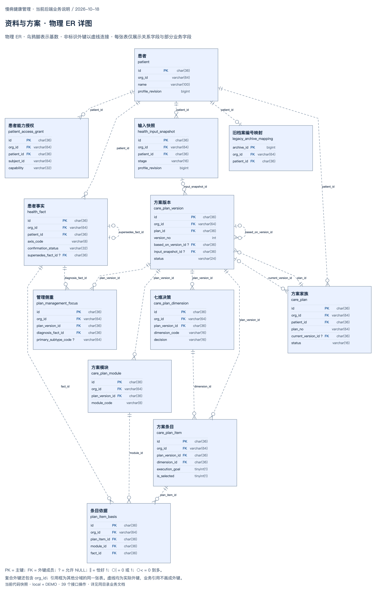
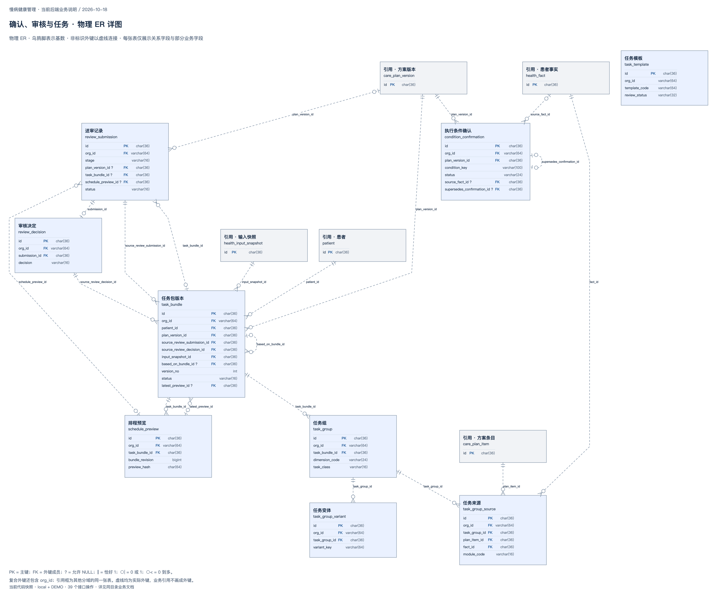
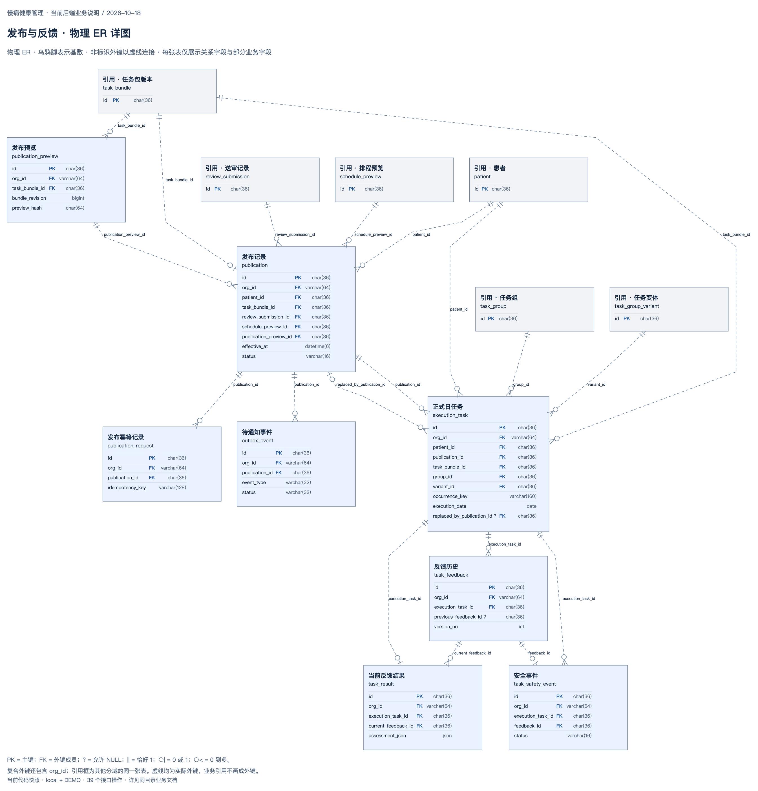
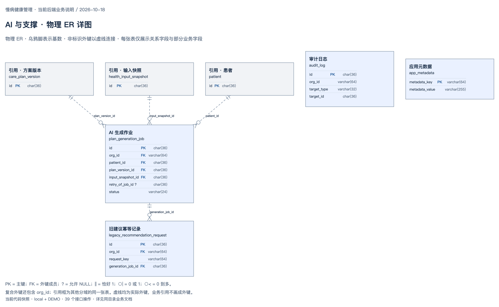

# 数据库 ER 图与关系说明

**2026-10-18 · Flyway V1—V11 · 33 张业务及支撑表 · 62 条物理外键**

本版按本机 MySQL `information_schema` 的列、主键、唯一键、外键和 CHECK 约束绘制，并与迁移脚本核对。只读取了结构元数据，没有导出患者记录、账号凭证或模型密钥。完整列定义保存在 [结构快照](database-schema.snapshot.json)。

先看 [核心 ER 总览](diagrams/backend-database-er.drawio.png)（[可编辑源文件](diagrams/backend-database-er.drawio)），再按业务域查下面的详图。总览选取 13 张表和主要外键；四张详图共同覆盖全部 33 张表、62 条外键，每条外键按其子表所属分域收录一次。

## 1. 图例与读法

- `PK`：主键；`FK`：实际外键的成员列。唯一约束另见末尾的约束索引，不能因为某一列参与联合唯一键，就把该列单独看成唯一。
- 字段后的 `?` 表示允许 NULL；没有 `?` 表示必须有值。`condition_confirmation.plan_version_id` 虽然列定义可空，CHECK 要求有值，图中按有效约束展示为必填。
- 乌鸦脚基数：`||` 为恰好一个，`○|` 为零或一个，`○<` 为零到多个。读法例如“一个患者可有零到多个方案；每个方案必须属于一个患者”。
- 虚线表示**实际存在的非标识外键**：子记录有自己的独立主键，父键不组成子记录主键。虚线不表示“猜测关系”或“未实现关系”。
- 蓝色框为本域实体；灰色“引用”框为其他域同一张表的简略展示，不是重复建表。引用框只展示主键。
- 连线文字显示业务外键列，省略共同的 `org_id`；实际外键均以 `(org_id, xxx_id)` 指向父表 `(org_id, id)`。总览为简洁省略 `org_id` 字段，详图保留。
- 图中只列主键、外键成员与部分关键业务字段。完整字段、联合唯一键和 CHECK 以结构快照及迁移文件为准。

## 2. 资料与方案（12 张表）



[编辑此图](diagrams/er-01-patients-plans.drawio)

患者事实、输入快照、方案家族和方案版本分别保存。方案版本下有模块、管理侧重、七维决策与条目；`plan_item_basis` 将一个条目具体绑定到模块和事实，保留依据来源。

`care_plan.current_version_id` 是当前版本指针；`care_plan_version.plan_id` 才是所有历史版本归属方案的关系，两条关系并不冲突。`based_on_version_id` 保留版本派生来源。数据库外键主要保证同组织的记录存在，“确属该方案的版本”等业务一致性仍需要服务层校验。

## 3. 确认、审核与任务（9 张本域表）



[编辑此图](diagrams/er-02-reviews-tasks.drawio)

一审和二审复用 `review_submission` / `review_decision`。`stage=PLAN` 时必须绑定方案版本，任务及排程字段为空；`stage=TASK` 时必须绑定任务包与排程预览，方案版本字段为空。这是 CHECK 限制，不是同时审核两个对象。

每个方案版本或任务包可以有多次历史送审；`pending_slot` 联合唯一键只限制“同时至多一个待审”，并不把整个历史关系变成一对一。一条送审最多有一个正式审核决定；撤回可以没有审核决定。

任务包绑定一审提交、批准决定及 TASK 输入快照。`task_group_source` 保存每个任务组的方案条目与事实来源；任务组下可有多个变体。`task_bundle.latest_preview_id` 是最新排程指针，`schedule_preview.task_bundle_id` 保留全部预览归属。

`task_template` 是当前已有的模板表，但没有其他表通过物理外键指向它，因此保持为独立实体。模板选择和版本校验由任务生成与排程逻辑处理，不能在 ER 图里补造外键。

## 4. 发布与反馈（8 张本域表）



[编辑此图](diagrams/er-03-publication-feedback.drawio)

发布记录绑定已审核任务包、二审记录、冻结排程和发布预览。每个任务包最多一条发布记录；发布幂等请求单独保存。正式日任务记录具体日期、窗口、内容快照及后续替代发布关系。

一次日任务可有多条反馈历史，但最多一条当前结果。当前结果通过 `current_feedback_id` 指向用于本次评估的反馈；这是“当前指针”和“全部历史”的区别。异常反馈可产生安全事件，每条反馈最多一条事件，当前仍为 OPEN 待处置。

`outbox_event` 已落库，但真实消息通道尚未接通；存在事件表不等于已经实现短信或微信送达。

## 5. AI 与支撑（4 张本域表）



[编辑此图](diagrams/er-04-ai-support.drawio)

AI 作业绑定患者、目标方案版本和输入快照，保存候选、校验结果、状态、用量及提示词/规则版本。旧建议接口的幂等记录关联同一作业。生成成功不会直接替换草稿，人工采用才写入方案版本。

`audit_log` 按目标类型和目标编号记录操作，属于多态引用，没有指向所有业务表的物理外键；`app_metadata` 保存应用标记。图中两者独立展示。

## 6. 容易误读的关系

| 关系 / 字段 | 当前约束与含义 |
| --- | --- |
| 患者 → 旧档案编号 | `UNIQUE(org_id, patient_id)`，一个患者至多一个本系统旧档案别名 |
| 旧事实 → 新事实 | `supersedes_fact_id` 有真实自外键及联合唯一键，一条旧事实至多一个直接替代者 |
| 旧条件确认 → 新确认 | `supersedes_confirmation_id` 同样有真实自外键和唯一约束 |
| 方案版本 → 子版本 / 任务包 → 子任务包 | 存在自外键，但没有“每个父版本只允许一个后继”的唯一约束，因此可为一对多 |
| 送审 → 决定 / 任务包 → 发布 / 日任务 → 当前结果 | 均由子表的联合唯一键保证零或一，不画成一对多 |
| `task_feedback.previous_feedback_id` | 用于追加更正的业务引用；当前无物理外键，不画自外键 |
| `plan_generation_job.retry_of_job_id` | 重试来源的业务引用；当前无物理外键，不画自外键 |
| `condition_confirmation.task_bundle_id` | 预留列，当前 CHECK 要求为空；没有外键，也不是当前任务条件确认功能 |
| `task_group_source.module_code` | 保存来源模块代码，并非指向 `care_plan_module` 的物理外键 |
| `org_id`、`created_by`、`subject_id`、`reviewer_id` | 组织范围或操作主体标识；当前没有组织表、账号表，不补画虚构实体或关联 |

是否“可为空”和是否“可以执行业务动作”不同。例如方案版本的输入快照在列定义上可空，并不意味着未满足资料、条件或审核校验的对象可以发布。

## 7. 结构索引

以下索引由同一份结构快照生成，列出全部表的主键、实际外键数量，以及外键的准确列映射。`org_id` 范围唯一键不意味着组织表存在。表数量不含 `flyway_schema_history`。

<!-- SCHEMA-INDEX -->

### 7.1 全部表与唯一键

| 表 | 主键 | 外键数 | 主要联合唯一键（省略范围键 org_id + id） |
| --- | --- | --- | --- |
| 患者 `patient` | `id` | 0 | `org_id, external_system, external_archive_id` |
| 患者能力授权 `patient_access_grant` | `id` | 1 | `org_id, patient_id, subject_id, capability` |
| 患者事实 `health_fact` | `id` | 2 | `org_id, supersedes_fact_id` |
| 输入快照 `health_input_snapshot` | `id` | 1 | — |
| 旧档案编号映射 `legacy_archive_mapping` | `archive_id` | 1 | `org_id, patient_id` |
| 方案家族 `care_plan` | `id` | 2 | `org_id, plan_no` |
| 方案版本 `care_plan_version` | `id` | 3 | `org_id, plan_id, version_no` |
| 方案模块 `care_plan_module` | `id` | 1 | `org_id, plan_version_id, module_code` |
| 管理侧重 `plan_management_focus` | `id` | 2 | `org_id, plan_version_id, diagnosis_fact_id` |
| 七维决策 `care_plan_dimension` | `id` | 1 | `org_id, plan_version_id, dimension_code` |
| 方案条目 `care_plan_item` | `id` | 2 | — |
| 条目依据 `plan_item_basis` | `id` | 3 | `org_id, plan_item_id, module_id, fact_id` |
| 执行条件确认 `condition_confirmation` | `id` | 3 | `org_id, supersedes_confirmation_id` |
| 送审记录 `review_submission` | `id` | 3 | `org_id, plan_version_id, pending_slot`；`org_id, task_bundle_id, pending_slot` |
| 审核决定 `review_decision` | `id` | 1 | `org_id, submission_id` |
| 任务模板 `task_template` | `id` | 0 | `org_id, template_code, version_no` |
| 任务包版本 `task_bundle` | `id` | 7 | `org_id, plan_version_id, version_no` |
| 任务组 `task_group` | `id` | 1 | — |
| 任务变体 `task_group_variant` | `id` | 1 | `org_id, task_group_id, variant_key` |
| 任务来源 `task_group_source` | `id` | 3 | `org_id, task_group_id, plan_item_id, fact_id, module_code` |
| 排程预览 `schedule_preview` | `id` | 1 | — |
| 发布预览 `publication_preview` | `id` | 1 | — |
| 发布记录 `publication` | `id` | 5 | `org_id, task_bundle_id` |
| 发布幂等记录 `publication_request` | `id` | 1 | `org_id, idempotency_key` |
| 正式日任务 `execution_task` | `id` | 6 | `org_id, publication_id, occurrence_key` |
| 待通知事件 `outbox_event` | `id` | 1 | `org_id, publication_id, event_type` |
| 反馈历史 `task_feedback` | `id` | 1 | `org_id, idempotency_key`；`org_id, execution_task_id, version_no` |
| 当前反馈结果 `task_result` | `id` | 2 | `org_id, execution_task_id` |
| 安全事件 `task_safety_event` | `id` | 2 | `org_id, feedback_id` |
| AI 生成作业 `plan_generation_job` | `id` | 3 | `org_id, created_by, idempotency_key` |
| 旧建议幂等记录 `legacy_recommendation_request` | `id` | 1 | `org_id, created_by, request_key` |
| 审计日志 `audit_log` | `id` | 0 | — |
| 应用元数据 `app_metadata` | `metadata_key` | 0 | — |

### 7.2 全部物理外键

下表的基数按外键、NULL 约束和联合唯一键计算；审核目标还受第 3 节互斥 CHECK 限制。

| 子表与外键名 | 子列 → 父表（列） | 每个子记录对应父记录数 | 每个父记录对应子记录数 |
| --- | --- | --- | --- |
| `patient_access_grant`；`fk_patient_access_grant_patient_id` | `(org_id, patient_id)` → `patient(org_id, id)` | 1 | 0..N |
| `health_fact`；`fk_health_fact_patient_id` | `(org_id, patient_id)` → `patient(org_id, id)` | 1 | 0..N |
| `health_fact`；`fk_health_fact_supersedes_fact_id` | `(org_id, supersedes_fact_id)` → `health_fact(org_id, id)` | 0..1 | 0..1 |
| `health_input_snapshot`；`fk_health_input_snapshot_patient_id` | `(org_id, patient_id)` → `patient(org_id, id)` | 1 | 0..N |
| `legacy_archive_mapping`；`fk_legacy_archive_patient` | `(org_id, patient_id)` → `patient(org_id, id)` | 1 | 0..1 |
| `care_plan`；`fk_care_plan_current_version_id` | `(org_id, current_version_id)` → `care_plan_version(org_id, id)` | 0..1 | 0..N |
| `care_plan`；`fk_care_plan_patient_id` | `(org_id, patient_id)` → `patient(org_id, id)` | 1 | 0..N |
| `care_plan_version`；`fk_care_plan_version_based_on_version_id` | `(org_id, based_on_version_id)` → `care_plan_version(org_id, id)` | 0..1 | 0..N |
| `care_plan_version`；`fk_care_plan_version_input_snapshot_id` | `(org_id, input_snapshot_id)` → `health_input_snapshot(org_id, id)` | 0..1 | 0..N |
| `care_plan_version`；`fk_care_plan_version_plan_id` | `(org_id, plan_id)` → `care_plan(org_id, id)` | 1 | 0..N |
| `care_plan_module`；`fk_care_plan_module_plan_version_id` | `(org_id, plan_version_id)` → `care_plan_version(org_id, id)` | 1 | 0..N |
| `plan_management_focus`；`fk_plan_management_focus_diagnosis_fact_id` | `(org_id, diagnosis_fact_id)` → `health_fact(org_id, id)` | 1 | 0..N |
| `plan_management_focus`；`fk_plan_management_focus_plan_version_id` | `(org_id, plan_version_id)` → `care_plan_version(org_id, id)` | 1 | 0..N |
| `care_plan_dimension`；`fk_care_plan_dimension_plan_version_id` | `(org_id, plan_version_id)` → `care_plan_version(org_id, id)` | 1 | 0..N |
| `care_plan_item`；`fk_care_plan_item_dimension_id` | `(org_id, dimension_id)` → `care_plan_dimension(org_id, id)` | 1 | 0..N |
| `care_plan_item`；`fk_care_plan_item_plan_version_id` | `(org_id, plan_version_id)` → `care_plan_version(org_id, id)` | 1 | 0..N |
| `plan_item_basis`；`fk_plan_item_basis_fact_id` | `(org_id, fact_id)` → `health_fact(org_id, id)` | 1 | 0..N |
| `plan_item_basis`；`fk_plan_item_basis_module_id` | `(org_id, module_id)` → `care_plan_module(org_id, id)` | 1 | 0..N |
| `plan_item_basis`；`fk_plan_item_basis_plan_item_id` | `(org_id, plan_item_id)` → `care_plan_item(org_id, id)` | 1 | 0..N |
| `condition_confirmation`；`fk_confirmation_fact` | `(org_id, source_fact_id)` → `health_fact(org_id, id)` | 0..1 | 0..N |
| `condition_confirmation`；`fk_confirmation_plan` | `(org_id, plan_version_id)` → `care_plan_version(org_id, id)` | 1 | 0..N |
| `condition_confirmation`；`fk_confirmation_prior` | `(org_id, supersedes_confirmation_id)` → `condition_confirmation(org_id, id)` | 0..1 | 0..1 |
| `review_submission`；`fk_review_plan` | `(org_id, plan_version_id)` → `care_plan_version(org_id, id)` | 0..1 | 0..N |
| `review_submission`；`fk_review_task_bundle` | `(org_id, task_bundle_id)` → `task_bundle(org_id, id)` | 0..1 | 0..N |
| `review_submission`；`fk_review_task_preview` | `(org_id, schedule_preview_id)` → `schedule_preview(org_id, id)` | 0..1 | 0..N |
| `review_decision`；`fk_decision_submission` | `(org_id, submission_id)` → `review_submission(org_id, id)` | 1 | 0..1 |
| `task_bundle`；`fk_bundle_base` | `(org_id, based_on_bundle_id)` → `task_bundle(org_id, id)` | 0..1 | 0..N |
| `task_bundle`；`fk_bundle_decision` | `(org_id, source_review_decision_id)` → `review_decision(org_id, id)` | 1 | 0..N |
| `task_bundle`；`fk_bundle_input` | `(org_id, input_snapshot_id)` → `health_input_snapshot(org_id, id)` | 1 | 0..N |
| `task_bundle`；`fk_bundle_patient` | `(org_id, patient_id)` → `patient(org_id, id)` | 1 | 0..N |
| `task_bundle`；`fk_bundle_plan` | `(org_id, plan_version_id)` → `care_plan_version(org_id, id)` | 1 | 0..N |
| `task_bundle`；`fk_bundle_preview` | `(org_id, latest_preview_id)` → `schedule_preview(org_id, id)` | 0..1 | 0..N |
| `task_bundle`；`fk_bundle_review` | `(org_id, source_review_submission_id)` → `review_submission(org_id, id)` | 1 | 0..N |
| `task_group`；`fk_group_bundle` | `(org_id, task_bundle_id)` → `task_bundle(org_id, id)` | 1 | 0..N |
| `task_group_variant`；`fk_variant_group` | `(org_id, task_group_id)` → `task_group(org_id, id)` | 1 | 0..N |
| `task_group_source`；`fk_source_fact` | `(org_id, fact_id)` → `health_fact(org_id, id)` | 1 | 0..N |
| `task_group_source`；`fk_source_group` | `(org_id, task_group_id)` → `task_group(org_id, id)` | 1 | 0..N |
| `task_group_source`；`fk_source_item` | `(org_id, plan_item_id)` → `care_plan_item(org_id, id)` | 1 | 0..N |
| `schedule_preview`；`fk_preview_bundle` | `(org_id, task_bundle_id)` → `task_bundle(org_id, id)` | 1 | 0..N |
| `publication_preview`；`publication_preview_ibfk_1` | `(org_id, task_bundle_id)` → `task_bundle(org_id, id)` | 1 | 0..N |
| `publication`；`publication_ibfk_1` | `(org_id, patient_id)` → `patient(org_id, id)` | 1 | 0..N |
| `publication`；`publication_ibfk_2` | `(org_id, task_bundle_id)` → `task_bundle(org_id, id)` | 1 | 0..1 |
| `publication`；`publication_ibfk_3` | `(org_id, review_submission_id)` → `review_submission(org_id, id)` | 1 | 0..N |
| `publication`；`publication_ibfk_4` | `(org_id, schedule_preview_id)` → `schedule_preview(org_id, id)` | 1 | 0..N |
| `publication`；`publication_ibfk_5` | `(org_id, publication_preview_id)` → `publication_preview(org_id, id)` | 1 | 0..N |
| `publication_request`；`publication_request_ibfk_1` | `(org_id, publication_id)` → `publication(org_id, id)` | 1 | 0..N |
| `execution_task`；`execution_task_ibfk_1` | `(org_id, patient_id)` → `patient(org_id, id)` | 1 | 0..N |
| `execution_task`；`execution_task_ibfk_2` | `(org_id, publication_id)` → `publication(org_id, id)` | 1 | 0..N |
| `execution_task`；`execution_task_ibfk_3` | `(org_id, task_bundle_id)` → `task_bundle(org_id, id)` | 1 | 0..N |
| `execution_task`；`execution_task_ibfk_4` | `(org_id, group_id)` → `task_group(org_id, id)` | 1 | 0..N |
| `execution_task`；`execution_task_ibfk_5` | `(org_id, variant_id)` → `task_group_variant(org_id, id)` | 1 | 0..N |
| `execution_task`；`execution_task_ibfk_6` | `(org_id, replaced_by_publication_id)` → `publication(org_id, id)` | 0..1 | 0..N |
| `outbox_event`；`outbox_event_ibfk_1` | `(org_id, publication_id)` → `publication(org_id, id)` | 1 | 0..N |
| `task_feedback`；`task_feedback_ibfk_1` | `(org_id, execution_task_id)` → `execution_task(org_id, id)` | 1 | 0..N |
| `task_result`；`task_result_ibfk_1` | `(org_id, execution_task_id)` → `execution_task(org_id, id)` | 1 | 0..1 |
| `task_result`；`task_result_ibfk_2` | `(org_id, current_feedback_id)` → `task_feedback(org_id, id)` | 1 | 0..N |
| `task_safety_event`；`task_safety_event_ibfk_1` | `(org_id, execution_task_id)` → `execution_task(org_id, id)` | 1 | 0..N |
| `task_safety_event`；`task_safety_event_ibfk_2` | `(org_id, feedback_id)` → `task_feedback(org_id, id)` | 1 | 0..1 |
| `plan_generation_job`；`plan_generation_job_ibfk_1` | `(org_id, patient_id)` → `patient(org_id, id)` | 1 | 0..N |
| `plan_generation_job`；`plan_generation_job_ibfk_2` | `(org_id, plan_version_id)` → `care_plan_version(org_id, id)` | 1 | 0..N |
| `plan_generation_job`；`plan_generation_job_ibfk_3` | `(org_id, input_snapshot_id)` → `health_input_snapshot(org_id, id)` | 1 | 0..N |
| `legacy_recommendation_request`；`legacy_recommendation_request_ibfk_1` | `(org_id, generation_job_id)` → `plan_generation_job(org_id, id)` | 1 | 0..N |

<!-- /SCHEMA-INDEX -->

## 8. 维护与复现

结构来源是 `src/main/resources/db/migration/V1…V11` 及本机已生效结构。图形、覆盖索引和文档都需跟随新增迁移更新，不能把这份日期快照当作永久最新。

```bash
# 仅在本机项目数据库就绪后刷新结构元数据，不读取业务行
python3 docs/business/diagrams/capture_schema.py
# 需要 Graphviz 的 dot 命令；生成原生可编辑图稿与完整关系索引
python3 docs/business/diagrams/build_er_use_cases.py
# 用 draw.io 桌面 CLI 导出 PNG，-e 将可编辑图数据嵌入 PNG
/Applications/draw.io.app/Contents/MacOS/draw.io -x -f png -e --theme light -s 1.2 -b 20 \
  -o docs/business/diagrams/backend-database-er.drawio.png \
  docs/business/diagrams/backend-database-er.drawio
```

另外四张 ER 详图及用例图使用相同导出命令。`build_reading_page.py` 会把主文档、接口索引与本附录汇总进浏览器阅读版。本文及图中不存在数据库行数据或密钥。
