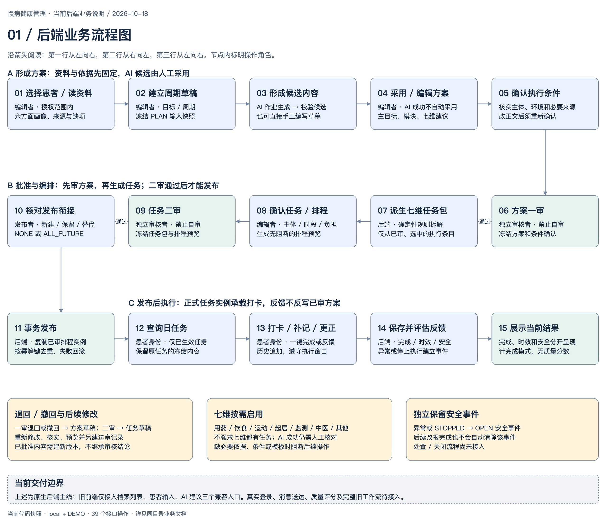
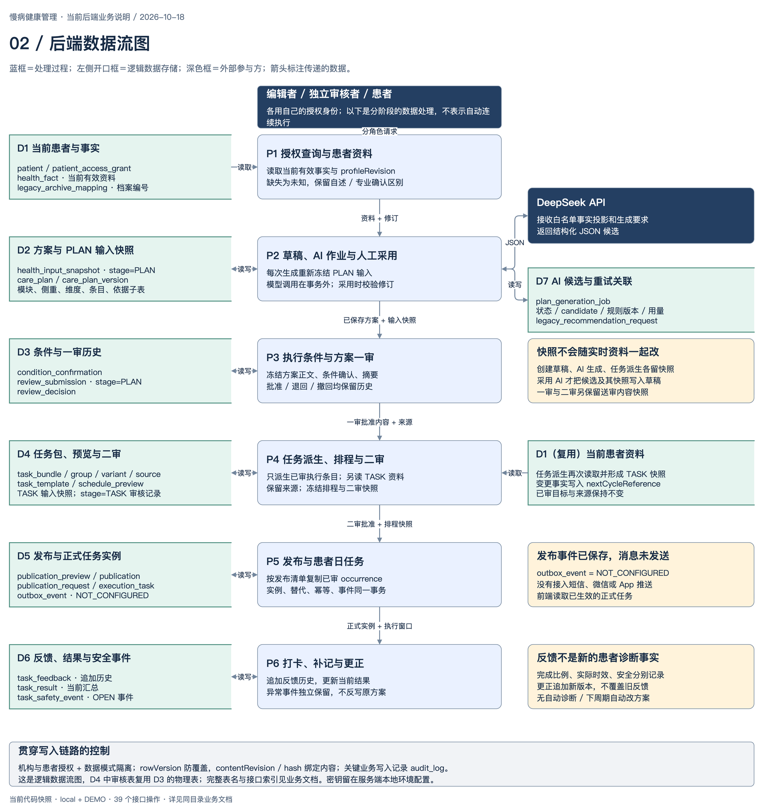
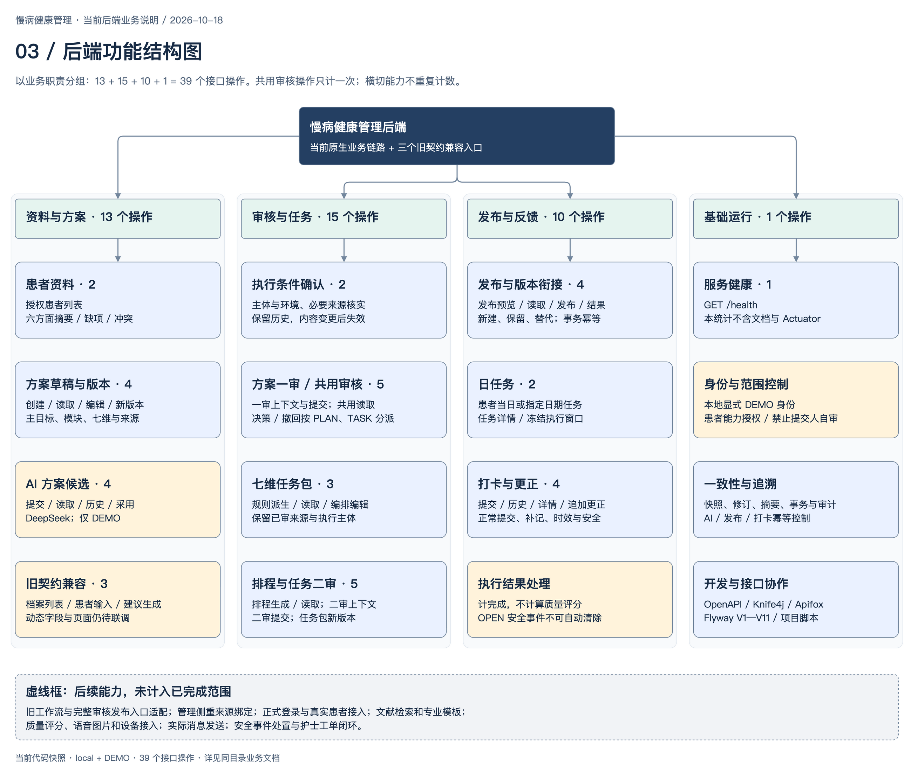
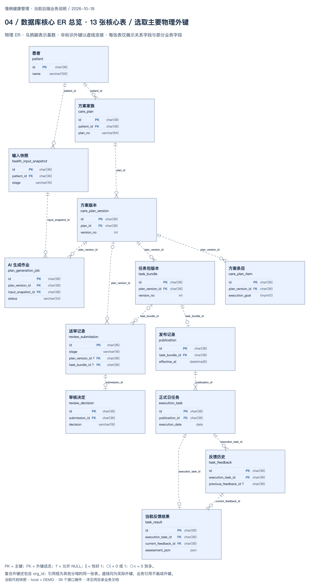
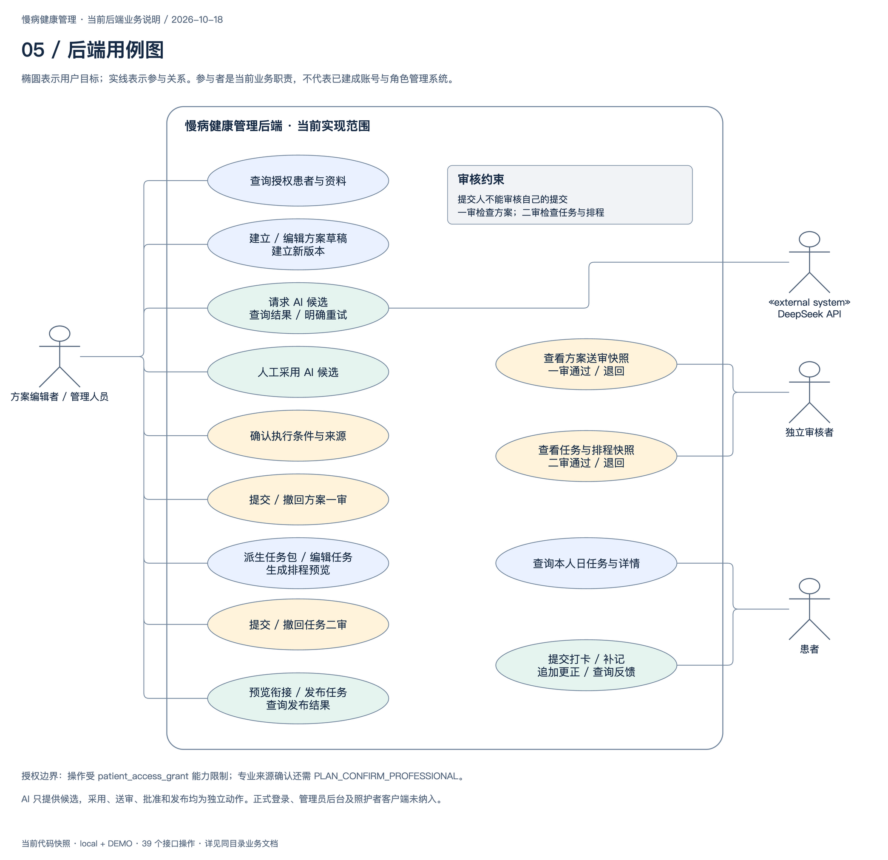

# 慢病健康管理后端业务说明

**版本：2026-10-18 · 当前实现快照**

本系统当前围绕演示视频的核心业务，支持“患者资料 → 方案形成 → 一审 → 七维任务与排程 → 二审 → 发布 → 日任务与打卡”。AI 用于生成方案候选；任务由已审方案按确定性规则派生。当前运行和验证范围为本地、显式开启的 DEMO 与虚构患者。

这份文档供开发成员、前端伙伴和项目负责人对齐业务使用。实现依据为当前 Controller/Service、Flyway V1—V11 和本机 OpenAPI；业务术语沿用[视频字段映射](../database/VIDEO-FIELD-MAPPING.md)及[AI 规则整理](../AI-PLAN-GENERATION.md)。它描述已经实现的后端，不把完整需求清单等同于已交付范围。

## 1. 阅读入口与当前范围

| 材料 | 解决的问题 | 可编辑源文件 |
| --- | --- | --- |
| [业务流程图](diagrams/backend-business-flow.drawio.png) | 谁在什么时候做什么；审核关口在哪里 | [draw.io 源文件](diagrams/backend-business-flow.drawio) |
| [数据流图](diagrams/backend-data-flow.drawio.png) | 资料从哪里来，何时冻结，落到哪些表 | [draw.io 源文件](diagrams/backend-data-flow.drawio) |
| [功能结构图](diagrams/backend-function-map.drawio.png) | 当前后端有哪些功能，如何分组 | [draw.io 源文件](diagrams/backend-function-map.drawio) |
| [数据库 ER 总览](diagrams/backend-database-er.drawio.png) | 核心实体、主外键与关系基数 | [draw.io 源文件](diagrams/backend-database-er.drawio) |
| [用例图](diagrams/backend-use-cases.drawio.png) | 各参与者能完成哪些业务目标 | [draw.io 源文件](diagrams/backend-use-cases.drawio) |
| [四个分域 ER 详图与结构索引](DATABASE-ER.md) | 全部 33 张表、62 条物理外键和唯一约束 | 各详图均提供 draw.io 源文件 |
| [业务功能协作清单](FEATURE-COLLABORATION-CHECKLIST.md) | 47 项子功能的 CRUD、角色、接口、建议页面与联调状态 | Markdown 清单 |
| [41 个接口索引](API-INDEX.md) | 业务节点对应哪个接口 | 由本次运行中的 OpenAPI 核对 |
| [浏览器阅读版](business-overview.html) | 连续查看说明、五张主图、四张 ER 详图及接口附录 | 由本 Markdown 及附录生成 |

本次核对：**36 个路径、41 个接口操作、33 张项目定义表**。表数量包含 `app_metadata` 和审计表，不包含 Flyway 自身的历史表。原生主线已实现；旧前端已有档案列表、患者输入、依据评估和 AI 建议四个兼容入口，尚不能只替换服务器地址就接通全部页面。

最近一轮 `./scripts/test-db.sh -o` 为 **169 项通过、零失败/错误/跳过**；新增侧重绑定与双病融合已做真实 DeepSeek 验证。详见[管理侧重与融合](../MANAGEMENT-FOCUS-AND-FUSION.md)。图形保留此前主流程结构，未单独展开本批侧重确认节点；本批未新增表，ER 结构不变。

## 2. 参与角色与业务对象

| 角色 | 当前可做的事 | 主要约束 |
| --- | --- | --- |
| 方案编辑者 / 管理人员 | 查询授权患者，建立和编辑草稿，采用 AI 候选，确认执行条件，编排任务、发布 | 能力按患者授权；普通编辑身份不能代用患者打卡身份 |
| 独立审核者 | 一审检查方案，二审检查任务与排程，通过或退回 | 提交人不能审核自己提交的内容；审核记录冻结并留痕 |
| 患者身份 | 查询自己的正式日任务，打卡、补记和追加更正 | 仅限有效授权、已生效且允许反馈的任务；不提供方案编辑权限 |
| 后台规则与 AI 作业 | 快照、结构与来源校验、候选生成、任务派生、排程、反馈评估 | AI 不自动采纳、审批或发布；结构校验不等于内容已经通过专业审核 |

以上是业务职责。当前通过三个本地 DEMO 身份及患者能力授权模拟，尚无正式账号注册、登录和组织管理流程。方案条目的 `actorType` 可以是本人、照护者、专业人员或共同执行，它描述“谁执行这件事”，不等同于已经实现相应角色的完整客户端。

**三组分类不能混为一谈：**

| 分类 | 内容 | 作用 |
| --- | --- | --- |
| 六方面画像 | H 健康阶段、F 功能、B 生活方式、C 照护、E 执行条件、G 当前问题 | 整理患者资料与缺失信息 |
| 六类方案模块 | B0 基础生活、L 习惯改善、R 风险复核、C 已确认慢病、F 功能照护、A 支持协同 | 解释本周期为什么采用这些管理措施 |
| 七维建议与任务 | 用药、饮食、运动、起居、监测、中医、其他 | 组织建议和后续执行任务；按需启用，不要求全部生成任务 |

**关键对象也分层保存：**患者事实是输入；方案是“本周期要做什么及其依据”；任务包是“已审建议如何执行”；排程预览是候选执行清单；正式任务实例是“某天某个时段的一次执行”；打卡记录是这次执行的反馈。

## 3. 业务流程

### 3.1 选患者并形成方案

1. 在授权患者列表选择患者，读取六方面摘要、事实来源、确认状态、缺项和冲突。未知资料保持未知，自述不会自动转为专业确认。
2. 建立周期草稿，保存标题、日期、时区等信息，冻结一份 PLAN 输入快照。也可以打开已有草稿继续编辑。
3. 若使用 AI，提交带修订号和幂等键的生成作业。服务端再次读取最新资料并单独冻结输入，再由后台调用 DeepSeek；生成过程不修改已有草稿。
4. 页面读取生成状态与候选。结构及引用校验成功后，编辑者明确采用，再编辑主目标、模块、管理侧重和七维建议。若生成期间草稿已经被别人修改，采用返回冲突，避免覆盖手工修改。
5. 也可手工形成方案内容，直接进入后续确认与审核，不以 AI 为必经条件。

AI 候选保存在 `plan_generation_job`；人工采用才把该候选及其输入快照写入方案版本。**生成成功、人工采用、一审通过是三个不同事件。**

### 3.2 核实条件并完成一审

有执行目标的已选条目，需要核实执行主体与环境。用药条目还需绑定快照中已专业确认的已有医嘱；中医执行缺少医学审核模板时阻断。正文变化会使旧确认失效，不能沿用不匹配的确认结果。

送审前检查主目标与事实依据、模块、七维决策、已选条目、必要条件及来源。存在阻断问题时不能送审。成功送审后，冻结方案与条件清单，独立审核者决定通过或退回。

一审通过后，方案版本只读。退回或提交人撤回后，回到草稿修改，旧送审内容和意见保留。已批准后需要调整，建立新版本并重新走审核，不能覆盖原结论。

### 3.3 从方案派生任务并完成二审

只选取当前有效已批准方案中满足“已选择、具有执行目标、所属维度已启用”的条目。后台按确定性规则建立任务组，保留原方案条目、模块、事实、主体和模板版本。

任务生成时再次读取当前资料，保存 TASK 快照。相比原方案输入出现的变更事实进入 `nextCycleReference`，作为下一周期参考，不直接修改本次已审目标和原始来源。

编辑者核实任务执行细节，配置允许调整的时段、必做/自选、优先级和说明，再生成排程预览。原始医学内容、来源和主体不可通过任务编辑任意替换。预览检查执行窗口、数量与负担、模板、来源及规则限制；有阻断则先修改。

二审冻结任务包及当前排程预览。退回或撤回回到任务草稿；批准后的调整需要新任务包版本、新预览和重新二审。**方案一审检查“做什么及依据”，任务二审检查“怎么执行及排程”。**

### 3.4 发布、执行和反馈

发布前明确生效时间及版本衔接，预览新建、保留、替代清单。正式发布在同一事务复制二审冻结排程中的实例，同时保存发布记录、未来任务替代、幂等记录、事件和审计。发布不重新调用 AI，也不重新推导一套排程。

生效后患者可以查询日任务和详情。打卡可一键自述完成，也可反馈部分完成、未做、停止执行、实际执行时间和备注。服务器区分正常提交与补记；更正追加新版本，保留旧记录。

反馈分别形成完成情况、执行时效、反馈完整性和安全状态。当前为 `COMPLETION_ONLY`，质量状态为 `NOT_APPLICABLE`，没有质量分数。异常或停止执行产生独立 `OPEN` 安全事件；后来改报完成不会自动解除。安全处置、事件关闭和护士工单闭环仍待实现。

### 3.5 关键状态及退回路径

| 对象 | 当前正常状态路径 | 失败、退回或修改路径 |
| --- | --- | --- |
| AI 生成作业 | `PENDING → RUNNING → SUCCEEDED → APPLIED` | 校验不通过 `REJECTED`；调用失败 `FAILED`；明确重试建立新作业 |
| 方案版本 | `DRAFT → IN_REVIEW → APPROVED` | 退回 / 撤回回到 `DRAFT`；批准后调整建立新版本 |
| 任务包 | `DRAFT → IN_REVIEW → APPROVED → PUBLISHED` | 退回 / 撤回回到 `DRAFT`；已批准后调整建立新包并重新审核 |
| 一次送审记录 | `PENDING → APPROVED` | 或终结为 `RETURNED / WITHDRAWN`；重新送审另建记录 |
| 安全事件 | 反馈触发后为 `OPEN` | 当前没有关闭接口，不因后续更正而清除 |

表中只列当前已开放业务路径，不把数据库预留状态视为已经实现的功能。

## 4. 数据流与保存边界

### 4.1 从实时资料到不可变执行依据

| 时点 | 输入 | 保存结果 | 后续是否跟随实时资料变化 |
| --- | --- | --- | --- |
| 查询患者摘要 | 当前有效患者事实与授权 | 仅返回摘要，不因 GET 创建快照 | 再次查询可得到更新资料 |
| 创建方案草稿 | 当前患者摘要、周期信息 | 方案身份、版本、PLAN 快照 | 原快照固定 |
| 提交 AI 作业 | 最新资料、补充要求、当前目标与周期 | 新 PLAN 快照、模型输入、提示词/规则版本、作业记录 | 候选与本次输入绑定，不静默重算 |
| 人工采用 AI | 校验通过的候选、匹配的草稿修订 | 草稿内容和快照引用更新，作业记为 APPLIED | 后续编辑须经过修订校验 |
| 方案一审 | 已保存方案与有效条件确认 | PLAN 阶段送审快照、摘要、审核决定 | 冻结，历史保留 |
| 派生任务 | 已审方案 + 最新患者摘要 | 任务包、TASK 快照、来源关联、变更事实参考 | 保留已审目标和来源 |
| 排程与二审 | 任务编排、模板和执行规则 | 完整 occurrences、摘要、TASK 阶段送审快照 | 修改编排后需新预览、重审 |
| 发布 | 二审通过内容与发布衔接清单 | 正式任务实例及冻结执行窗口 | 不随新草稿自动变化；替代另有明确规则 |
| 打卡与更正 | 正式任务实例、患者反馈、接收时间 | 不可变反馈、当前汇总、安全事件 | 追加版本，不覆盖历史，不自动反写诊断事实 |

### 4.2 逻辑数据存储对应的真实表

图中 D1—D7 是阅读用的逻辑分组，不是另外创建的数据库。

| 分组 | 真实表 | 职责 |
| --- | --- | --- |
| D1 患者资料与范围 | `patient`、`patient_access_grant`、`health_fact`、`legacy_archive_mapping` | 患者、能力授权、当前事实、旧数字档案别名 |
| D2 方案与输入 | `health_input_snapshot`、`care_plan`、`care_plan_version`、`care_plan_module`、`plan_management_focus`、`care_plan_dimension`、`care_plan_item`、`plan_item_basis` | 方案版本、输入快照及模块/侧重/七维条目/事实依据 |
| D3 条件与审核 | `condition_confirmation`、`review_submission`、`review_decision` | 条件核实、送审冻结与决定；审核表供 PLAN/TASK 两阶段共用 |
| D4 任务与排程 | `task_template`、`task_bundle`、`task_group`、`task_group_variant`、`task_group_source`、`schedule_preview` | 任务模板、包、组、候选动作、来源及排程快照 |
| D5 发布与正式实例 | `publication_preview`、`publication`、`publication_request`、`execution_task`、`outbox_event` | 衔接清单、发布幂等、正式实例及待接消息通道的事件 |
| D6 执行反馈 | `task_feedback`、`task_result`、`task_safety_event` | 不可变反馈、当前结果及独立安全事件 |
| D7 AI 与旧请求关联 | `plan_generation_job`、`legacy_recommendation_request` | 候选、状态、模型用量和同键请求复用 |
| 公共存储 | `audit_log`、`app_metadata` | 关键业务变更审计及应用元数据 |

`health_input_snapshot` 同时保存 PLAN 和 TASK 阶段输入；D4 中二审记录复用 D3 的审核表。图中的重复展示不代表重复建表。

### 4.3 AI 外部传输边界

模型密钥只在服务端环境配置中使用。后端向 DeepSeek 发送白名单投影的事实内容、来源类别、确认状态、时间、缺项与冲突，以及目标、周期和生成要求；不主动发送姓名、患者主键、联系方式等字段。自由文本仍可能包含身份信息，因此当前仅允许虚构 DEMO，不能把字段投影称作通用脱敏能力。

系统保存生成输入、原始输出、校验后候选、提示词与规则版本和用量，用于追溯。面向前端的生成详情不返回密钥、系统提示词或原始模型文本。模型调用在数据库事务之外执行；返回的原始内容留档，通过校验后才保存为可采用的候选，校验不通过则记录拒绝状态。

### 4.4 前端必须区分的编号和修订

| 字段 | 指向什么 | 注意事项 |
| --- | --- | --- |
| `patientId / archiveId` | 原生患者 UUID / 旧契约数字档案别名 | 两者映射后才能使用；旧大整数保持字符串，不转 Number |
| `planId / versionId` | 同一方案家族 / 某个具体版本 | 审核和任务来源绑定具体版本，不只绑定家族 |
| `generationJobId / adviceId` | 本机 AI 作业 / 旧建议入口返回的同一作业编号 | 不把它当作 workflowId；人工采用仍是独立动作 |
| `taskBundleId / executionTaskId` | 任务编排版本 / 某天某时段的正式实例 | 前者用于编辑与审核，后者用于打卡 |
| `reviewSubmissionId` | 一次 PLAN 或 TASK 送审 | 审核决定使用该提交自己的 rowVersion |
| `profileRevision` | 患者资料修订 | 创建草稿、生成 AI 时检查资料是否变化 |
| `rowVersion / contentRevision / hash` | 资源修订 / 正文修订 / 内容摘要 | 防止覆盖、旧确认或旧预览误用；不同资源的修订不能混用 |

原生 AI、发布、打卡使用 `Idempotency-Key`；旧同步建议入口使用 `X-Request-Id` 关联重复请求。相同键与相同正文复用结果，改正文复用同键则冲突；重试也要重新检查有效授权。

## 5. 功能结构与接口分组

| 功能分组 | 接口数 | 当前包含 |
| --- | --- | --- |
| 资料与方案 | 15 | 患者及管理依据 3、草稿与版本 4、AI 候选 4、旧契约兼容 4 |
| 审核与任务 | 15 | 条件确认 2、一审与共用审核 5、任务包 3、排程与二审 5 |
| 发布与反馈 | 10 | 发布 4、日任务 2、打卡与更正 4 |
| 基础运行 | 1 | 服务健康检查；认证、审计、文档等横切能力不重复计操作数 |
| 合计 | 41 | 从当前业务 OpenAPI 中按 HTTP 方法 + 路径计数 |

同一个审核读取、决策、撤回入口按 `stage` 服务于一审和二审，所以没有为二审再重复增加三项接口。文档页面、OpenAPI 自身、Actuator 和模拟前端页面不纳入上述 41 个业务文档操作。

## 6. 数据库 ER 图

总览选择 13 张核心表，展示“患者 → 方案家族/版本 → 任务包 → 发布 → 正式日任务 → 反馈/当前结果”，并关联输入快照、AI 作业和两阶段共用审核记录。它是一张实体关系图，连线表示数据库外键，不代表操作先后。

已按本机 V1—V11 生效结构核对全部 **33 张表、62 条物理外键**。详细图分为资料与方案、确认审核与任务、发布与反馈、AI 与支撑四个域，见 [ER 图与关系说明](DATABASE-ER.md)。主键、复合外键、零或一/一对多，以及版本指针和历史归属均分别标明。

图中虚线是实际存在的非标识外键；没有外键的重试来源、反馈更正指针和审计目标只在字段及说明中标注。当前无组织表、账号表，不因出现 `org_id` 或操作人编号就补画实体。

## 7. 用例图与参与边界

用例图围绕用户目标绘制，实线只表示参与关系，不表示先后顺序。一次用例可能调用多个接口；41 个接口不需要逐个拆成用例椭圆。

| 参与者 | 图中业务目标 | 对应能力 / 约束 |
| --- | --- | --- |
| 方案编辑者 / 管理人员 | 查询资料、编辑或形成新版本、请求及采用 AI 候选、确认条件、送审/撤回、派生编排任务、预览与发布 | `PATIENT_READ`、`PLAN_EDIT`、`PLAN_CONFIRM`、`TASK_READ`、`TASK_EDIT`、`TASK_PUBLISH`；用药来源确认另需 `PLAN_CONFIRM_PROFESSIONAL` |
| 独立审核者 | 查看冻结方案或任务排程，完成一审/二审的通过或退回 | `PLAN_REVIEW` / `TASK_REVIEW` 及对应读取能力；禁止审核本人提交 |
| 患者 | 查询本人的日任务和详情，打卡、补记、更正及读取反馈 | `TASK_READ`、`TASK_FEEDBACK`；按患者授权和任务窗口限制 |
| 外部 DeepSeek API | 参与方案候选生成 | 只与后端 AI 作业通信；不参与人工采用、审核或发布 |

这里的角色是当前业务职责与 DEMO 授权组合；不等同于已经实现正式角色管理。正式管理员、完整照护者/专业人员客户端、自动医学审批和消息推送尚未纳入用例图。

## 8. 与伙伴前端的对齐边界

| 旧文档能力 | 当前情况 |
| --- | --- |
| 授权档案列表 | 已适配：`GET /store/care/grant-administration/archives` |
| 患者输入 | 已适配入口：`GET /store/care/archives/{archiveId}/input`；旧规范为动态对象，页面具体取值待核对 |
| AI 方案建议 | 已适配入口：`POST /store/care/drafts/recommendations/generate`；返回真实候选，分类与状态字符串仍需页面确认 |
| 非空 `confirmedManagement` | 已接入：须原样回传依据评估的 evaluation/sourceHash；人工确认侧重，后端计算融合 |
| 数字组织编号映射 | 未配置；本机 DEMO 不等于旧服务器账号范围 |
| 旧工作流、条件确认、动作拆解、审核、发布和反馈入口 | 尚未完整适配；相应原生业务能力不能等同于旧路由已可调用 |

旧建议入口目前创建暂定 7 天的内部草稿、提交 AI 作业并等待候选；`actions=[]`、`decompositionPending=true` 表示动作尚未通过旧入口拆解。不会自动采纳、送审、发布，也不把内部方案版本伪装成旧工作流编号。详见[前端契约对齐](../FRONTEND-CONTRACT-ALIGNMENT.md)。

## 9. 当前未完成的业务能力

- 伙伴旧工作流全链路适配与完整页面联调；医学自动判型规则启用及更完整的多病语义冲突校验。
- 正式身份登录、组织与成员管理、真实患者接入；患者建档及资料维护尚无正式对外写入接口。
- 文献检索与来源核验、医学审核内容库、药物/中医等完整专业参数和模板接入。
- 完整质量评分、依从性统计报表；当前完成比例不等于质量合格。
- 语音、图片、设备数据接入，以及短信、微信、App 等真实通知送达。
- 安全事件处置/关闭、护士工单及随访服务闭环；反馈不会自动生成下一周期方案。

这些能力可以作为后续开发项，不计入本版“已实现”的主线。涉及视频目标的下一步优先完成旧工作流与管理侧重衔接，再推进前后端联合验证。

## 10. 开发定位与文档维护

| 业务 | 主要代码位置 |
| --- | --- |
| 患者范围与摘要 | `PatientServiceImpl`、`LegacyArchiveResolver`、`LegacyCareInputService` |
| 方案编辑与校验 | `CarePlanServiceImpl`、`PlanDraftValidation`、`PlanVersionServiceImpl` |
| AI 生成与采用 | `PlanGenerationService`、`PlanGenerationWorker`、`DeepSeekPlanClient`、`AiPlanPolicy` |
| 条件确认和一审 | `ConditionConfirmationServiceImpl`、`PlanReviewServiceImpl`、`PlanReviewSupport` |
| 任务派生和二审 | `TaskGenerationService`、`TaskScheduleService`、`TaskReviewService` |
| 发布和反馈 | `TaskPublicationService`、`TaskFeedbackService`、`TaskFeedbackPolicy` |
| 数据结构 | `src/main/resources/db/migration/V1…V11`；历史迁移不覆盖修改 |

以上服务均位于 `src/main/java/com/healthsystem/service/impl/`。接口按 Controller 定位，完整条目见 [API 索引](API-INDEX.md)。原始阶段文档中的“后续实现”是当时批次的历史描述，当前进度以本版和最新专项验证记录为准。

图稿可直接在 draw.io 编辑；PNG 内也嵌入了可编辑图数据。`diagrams/build_diagrams.py` 生成业务流、数据流、功能图；`diagrams/build_er_use_cases.py` 根据结构快照生成 ER 图和用例图，维护方式见 [ER 附录](DATABASE-ER.md)。若直接修改 draw.io 图稿，后续不要运行旧生成器覆盖手工布局，应先同步相应修改。浏览器阅读版由 `build_reading_page.py` 根据本文件、接口索引及 ER 附录生成。

本次只新增文档、图稿和文档生成脚本，并在项目 README 增加入口。未修改业务逻辑、数据库迁移或运行环境。

文档检查：五张主图和四张 ER 详图均已逐张查看；draw.io XML、PNG 内嵌可编辑图数据、文档本地链接、阅读版导航锚点及接口索引检查通过。ER 覆盖清单与结构快照核对为 33 张表、62 条外键。此轮只核查文档与图稿，没有重新运行后端测试或付费 AI 调用。
